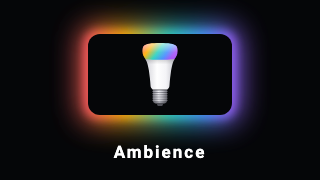
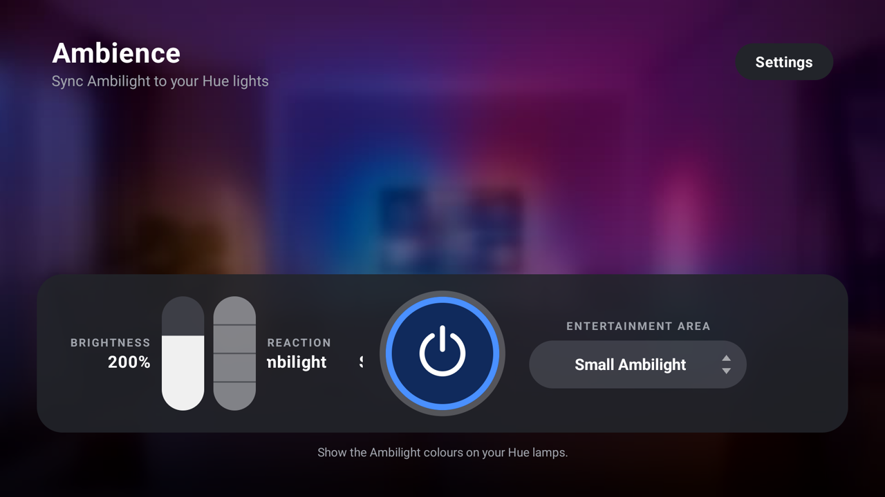
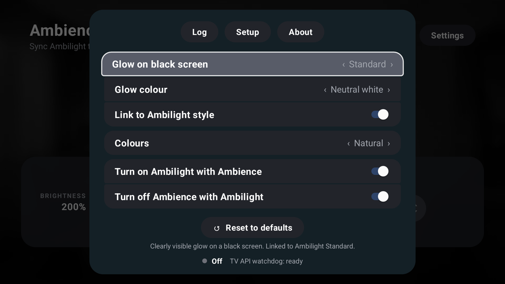

<p align="center"></p>

# Ambience

**Sync Ambilight to your Hue lights.** Ambience is a small Android TV app that runs on a Philips Ambilight TV and mirrors the TV's Ambilight colours onto the lamps of a Hue entertainment area in real time.

> **Disclaimer:** This project is an independent open-source tool and is not affiliated with, endorsed, or sponsored by Koninklijke Philips N.V., Signify Holding, or TP Vision. "Philips", "Ambilight", "Philips Hue" and "Hue" are trademarks of their respective owners and are used here only to describe what the app works with.

## Screenshots

| Main screen | Settings |
|---|---|
|  |  |

## How it works

- Ambience runs **on the TV itself** as a foreground service.
- It reads the colours the TV's Ambilight LEDs are currently showing from the TV's local **JointSpace API** (`https://127.0.0.1:1926`, digest login obtained by PIN pairing).
- It streams those colours to a **Hue entertainment area** with the Hue **Entertainment API** (DTLS over UDP), mapping each lamp to the matching side of the screen.
- No screen capture is involved. Because Ambience only follows what Ambilight shows, it works with every source Ambilight works with, including DRM-protected streaming apps.

## Features

- Guided first setup: pair the TV with a PIN, find and link the Hue Bridge, choose the entertainment area, measure the TV's white point, allow the optional watchdog.
- Main screen with brightness, reaction speed (optionally following the Ambilight style), entertainment area and an on/off button.
- Settings for glow, colour tone and colours, and for switching Ambience on or off together with Ambilight.
- Intents for remote buttons and automation apps: `tv.ambience.sync.TOGGLE`, `.ON`, `.OFF`, `.AMBILIGHT`, `.NEXT_AREA`, `.RELOAD` (as broadcast to `.ControlReceiver` or activity `.ControlActivity`).
- Optional watchdog that restarts a hung Ambilight service via local ADB (needs "Always allow" on the TV once).

## Requirements

- A Philips Android TV / Google TV with Ambilight and the JointSpace API (tested on a 2023 OLED).
- A Hue Bridge (square, v2) with at least one entertainment area, set up in the Hue app.

## Build

No Gradle. `build.sh` uses the Android SDK build tools directly:

- OpenJDK 21 (`JAVA_HOME` in `build.sh`)
- Android command-line tools with `build-tools;34.0.0` and `platforms;android-34` (path `SDK` in `build.sh`)

```bash
./build.sh
adb install -r build/huesync.apk
```

On first run `build.sh` creates a local signing key `debug.keystore`. It is not part of the repository.

`core/` is the platform-independent engine (TV API, Hue setup, DTLS, colour mapping). `cli/` with `cli.sh` runs it on a computer for testing; it reads credentials from `../tv.env` and `../hue.env`, which are never committed.

## Notes

- TV pairing uses the shared pairing secret that is widely published in open-source JointSpace clients. The JointSpace API is not officially documented by the TV maker; endpoints may differ between models and firmware versions.
- Credentials (TV login, Hue application key and client key) are created on the device during setup and stored only in the app's private storage.

## License

MIT, see [LICENSE](LICENSE). Created by Börni (burni2001).
